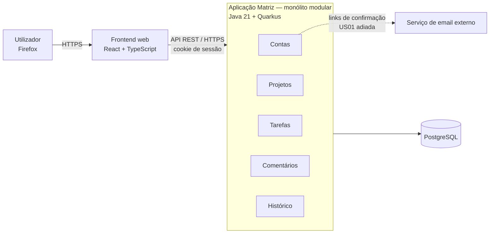
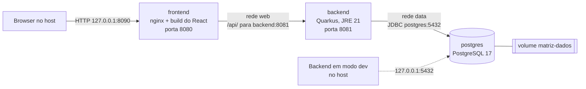

# Arquitetura — Matriz

Este documento regista a arquitetura escolhida para o MVP da Matriz e a sua
justificação. Responde à decisão **D03** de
[constraints.md](constraints.md). As tecnologias foram escolhidas na Ficha
PL 03 (D01, D02, D06; ver secção 7).

## 1. Decisão

A Matriz é construída como um **monólito modular**: uma única aplicação,
entregue e executada como um todo, organizada internamente em módulos com
responsabilidades bem separadas.

## 2. Contexto

Fatores do MVP que pesam na escolha:

- **Escala pequena:** até 50 pessoas (RNF04), uma única empresa (RN01).
- **Âmbito limitado:** 17 User Stories (US01 a US14 e US16 a US18), com a
  US01 adiada.
- **Regras que cruzam áreas:** desativar uma conta mexe nos projetos e nas
  tarefas (RN17, RN18); remover um membro mexe nas tarefas (RN08); alterar
  uma tarefa gera histórico (RF13); eliminar um projeto apaga tudo o que ele
  contém (RN22).
- **Segurança:** as permissões têm de ser verificadas no servidor (S03, S04).

## 3. Alternativas consideradas

| Critério                   | Monólito tradicional                  | Monólito modular                                   | Microservices                                     |
|----------------------------|---------------------------------------|----------------------------------------------------|---------------------------------------------------|
| Entrega                    | Uma aplicação                         | Uma aplicação                                      | Vários serviços independentes                     |
| Organização interna        | Sem fronteiras claras entre áreas     | Módulos com responsabilidades separadas            | Cada serviço com os seus próprios dados           |
| Complexidade               | Baixa                                 | Baixa a média                                      | Alta (rede, deploy, dados distribuídos)           |
| Regras entre áreas         | Simples, mas tendem a misturar-se     | Simples, através de interfaces entre módulos       | Exigem comunicação entre serviços e consistência distribuída |
| Adequação ao MVP           | Funciona, mas tende a ficar confuso   | **Adequado**                                       | Desproporcionado para 50 pessoas                  |

## 4. Justificação

- **Simples de desenvolver e de pôr a correr:** uma só aplicação e uma só base
  de dados, adequado à escala e ao âmbito do MVP.
- **Fronteiras claras:** cada módulo tem uma responsabilidade, o que evita o
  "monólito confuso" e facilita perceber onde está cada regra de negócio.
- **Regras entre áreas sem complexidade distribuída:** as operações que
  envolvem vários módulos (ex.: desativar conta) correm dentro da mesma
  aplicação e da mesma base de dados.
- **Preparado para evoluir:** se um dia for necessário, um módulo pode ser
  separado sem reorganizar toda a aplicação.
- **Microservices rejeitados:** a escala e o âmbito não justificam o custo de
  operar e coordenar vários serviços.

## 5. Componentes

| Componente                  | Responsabilidade                                                                                     |
|-----------------------------|------------------------------------------------------------------------------------------------------|
| Frontend web                | Aplicação React (TypeScript, Vite) em português de Portugal, para Firefox em ecrãs a partir de 1280 px (RNF01–RNF03); o layout adapta-se a larguras menores, sem que isso passe a ser um requisito. Não decide permissões: apenas mostra o que o servidor permite. |
| Aplicação Matriz (backend)  | Aplicação Quarkus (Java 21). Expõe a API REST, aplica as regras de negócio e verifica as permissões no servidor (S03, S04). |
| Base de dados               | Uma única base de dados PostgreSQL, partilhada pelos módulos da aplicação. O esquema é criado por migrations Flyway. |
| Serviço de email externo    | Envia os links de confirmação de conta (RF01). Fornecedor por decidir (D05); só é necessário quando a US01 for implementada. |

Toda a comunicação entre o browser e o servidor é feita por HTTPS (S02).

### Execução com Docker Compose (Ficha PL 05)

Como os componentes acima correm hoje em contentores (`compose.yaml`; detalhe
em [deployment.md](deployment.md) e decisões no
[ADR 0002](decisions/0002-execucao-em-contentores-e-ci.md)):

| Serviço | Responsabilidade | Exposto no host |
|---------|------------------|-----------------|
| `frontend` | nginx sem root: serve o build do React e reencaminha `/api/` para o Backend, mantendo a mesma origem (o cookie funciona sem CORS) | `127.0.0.1:8090` |
| `backend` | A aplicação Quarkus, em JRE 21, sem root e com o sistema de ficheiros só de leitura | Não |
| `postgres` | A base de dados, com os dados no volume `matriz-dados` | `127.0.0.1:5432`, só para o modo de desenvolvimento |

O Frontend não chega à base de dados: estão em redes diferentes. Localmente,
a ligação é por HTTP; o HTTPS (S02) depende do alojamento (D04, pendente).
O serviço de email não existe nesta fase (US01 adiada).

## 6. Módulos e responsabilidades

| Módulo          | Responsabilidade                                                                                                   | Requisitos             |
|-----------------|--------------------------------------------------------------------------------------------------------------------|------------------------|
| **Contas**      | Registo com email da empresa e confirmação por link (adiados), login e logout, sessões, limite de tentativas, desativar e reativar contas de Membro | RF01, RF02, RF14       |
| **Projetos**    | Criar, editar, eliminar e pesquisar projetos, gerir membros e o Gestor, arquivar e reativar, calcular a percentagem de conclusão e as contagens do painel | RF03, RF04, RF08, RF10, RF16–RF18 |
| **Tarefas**     | Criar, editar e eliminar tarefas (com o registo das tarefas eliminadas), mudar estados, atribuir e remover responsáveis, controlo de versão, filtrar, quadro Kanban, lista "As minhas tarefas" | RF05–RF07, RF09, RF11, RF17 |
| **Comentários** | Comentar tarefas; só o autor edita ou apaga o seu comentário (PR11)                                                | RF12                   |
| **Histórico**   | Registar a criação e as alterações de cada tarefa (a consulta é da Fase 2)                                         | RF13                   |

### Interações entre módulos

Cada módulo só acede aos dados de outro através da interface desse módulo.
As principais interações são:

| Situação                              | Módulos envolvidos                       | Regra           |
|---------------------------------------|------------------------------------------|-----------------|
| Desativar uma conta de Gestor         | Contas → Projetos (nomear novo Gestor)   | RN17, PR14      |
| Desativar qualquer conta              | Contas → Tarefas (retirar as atribuições dessa pessoa); termina as sessões dessa pessoa | RN18, PR16 |
| Remover um membro de um projeto       | Projetos → Tarefas (retirar as atribuições dessa pessoa nas tarefas não concluídas) → Histórico | RN08, RI12 |
| Criar ou alterar uma tarefa           | Tarefas → Histórico                      | RF13            |
| Eliminar uma tarefa                   | Tarefas (deixa o registo da eliminação); as atribuições, os comentários e o histórico são apagados em cascata pela base de dados | RF09, PR08, RI17 |
| Eliminar um projeto                   | Projetos (as tarefas, os comentários e o histórico são apagados em cascata pela base de dados) | RN22, RI17 |
| Calcular a percentagem e as contagens | Projetos → Tarefas (contar estados)      | RF10, RF18, PR09 |
| Verificar se alguém é membro / Gestor | Tarefas → Projetos; Comentários → Tarefas → Projetos | S03, S04, RN20  |
| Atribuir um responsável               | Tarefas → Projetos (é membro ativo do projeto?) → Histórico | RI02, RI12 |

## 7. Tecnologias

Escolhidas na Ficha PL 03 (decisões em [constraints.md](constraints.md)).

| Camada        | Tecnologia                                                                                   | Decisão |
|---------------|----------------------------------------------------------------------------------------------|---------|
| Backend       | Java 21, Quarkus (REST com Jackson, Hibernate ORM com Panache, Hibernate Validator)           | D01     |
| Base de dados | PostgreSQL, executado em Docker (Docker Compose, com volume persistente); migrations Flyway   | D02     |
| Palavras-passe| Hash bcrypt (S01)                                                                            | S01     |
| Frontend      | React com TypeScript, criado com Vite; React Router para a navegação                         | D01     |
| Testes        | Backend: JUnit + RestAssured contra PostgreSQL criado pelo Quarkus Dev Services; Frontend: Vitest + Testing Library; E2E: Playwright (Firefox) | D11 |
| Contentores   | Docker e Docker Compose; nginx a servir o Frontend                                          | ADR 0002 |
| CI            | GitHub Actions: testes, build, imagens Docker, smoke tests e E2E                             | ADR 0002 |

### Organização do backend

Decisão e alternativas em
[ADR 0001](decisions/0001-arquitetura-interna-backend.md): **camadas por
módulo com DDD leve**.

Cada módulo da secção 6 corresponde a um package Java (um contexto
delimitado) com as suas próprias camadas:

- **recurso** — endpoints REST: recebe e devolve DTOs, nunca entidades;
- **serviço** — caso de uso: transação, verificação de permissões e
  comunicação com outros módulos;
- **domínio e persistência** — entidades JPA com comportamento, que protegem
  as suas invariantes (agregados `Projeto`, `Tarefa` e `Comentario`), e
  repositórios Panache.

Um package comum guarda o que é partilhado: o formato único de erro, a
autenticação (leitura do cookie e identificação do utilizador) e a
configuração. Um módulo só usa outro através do serviço desse módulo.

### Autenticação e sessão (D06)

1. No login, o backend verifica o email e a palavra-passe (bcrypt) e o
   limite de tentativas (D09).
2. Se estiverem corretos, gera um token aleatório, guarda o seu hash na
   tabela `sessao` e envia o token num cookie `HttpOnly`, `SameSite=Strict`
   (e `Secure` quando servido por HTTPS, S02).
3. Em cada pedido, o backend procura a sessão pelo hash do token, confirma que
   não passaram 30 minutos desde a última atividade e atualiza-a. Sem sessão
   válida, responde 401.
4. Sair apaga a sessão; desativar uma conta apaga todas as sessões dessa
   pessoa (PR16).

A identidade usada nas regras (autor de um comentário, Gestor de um projeto
novo, autor do histórico) vem sempre da sessão, e nunca de dados enviados
pelo cliente.

### Configuração e ambiente

- A configuração sensível (ligação à base de dados, conta de Administrador,
  D07) é lida de variáveis de ambiente. O repositório tem apenas um ficheiro
  de exemplo com valores fictícios (S08).
- Em desenvolvimento, o servidor do Vite reencaminha os pedidos `/api` para o
  backend, para que frontend e backend fiquem na mesma origem e o cookie
  funcione sem CORS. O endereço do backend fica num único sítio de
  configuração.
- No Docker Compose, o nginx faz o mesmo papel do proxy do Vite
  (`frontend/nginx.conf.template`), e o endereço da base de dados vem de
  `MATRIZ_DB_HOST` (ADR 0002).
- Em produção (Render e Neon, ADR 0006), o nginx reencaminha `/api` para o
  endereço público do Backend (`MATRIZ_API_URL`), e o Backend liga-se ao Neon
  com SSL (`MATRIZ_DB_SSLMODE=verify-full`).

## 8. Pressupostos e decisões pendentes

**Pressupostos desta arquitetura:**

- A comunicação entre frontend e backend é feita através de uma API REST
  (contrato em [../openapi.yaml](../openapi.yaml)).
- Existe uma única instalação da Matriz, para uma única empresa (RN01).

**Continuam pendentes**, entre outras (ver [constraints.md](constraints.md)):

| ID  | Decisão                                       |
|-----|-----------------------------------------------|
| D04 | Alojamento                                    |
| D05 | Serviço de envio de emails                    |
