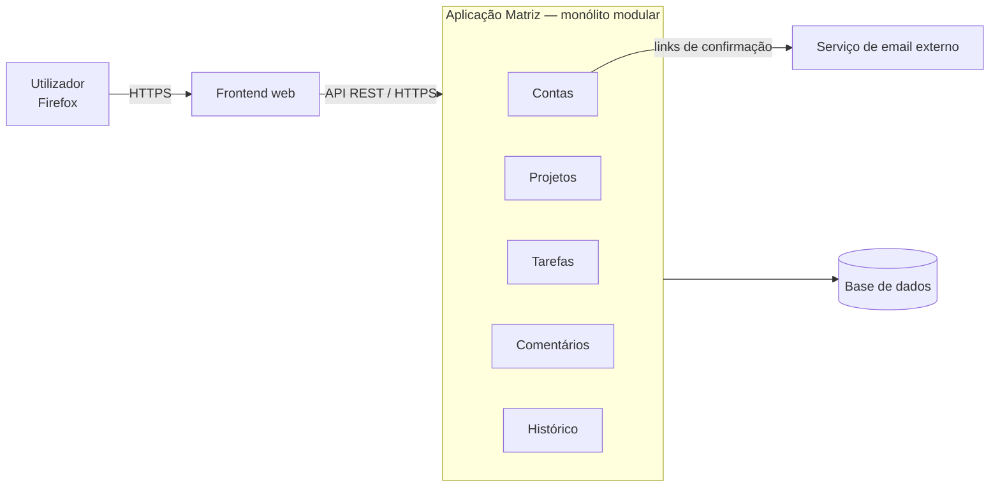

# Arquitetura — Matriz

Este documento regista a arquitetura escolhida para o MVP da Matriz e a sua
justificação. Responde à decisão **D03** de
[constraints.md](constraints.md). As tecnologias concretas continuam por
decidir (ver secção 7).

## 1. Decisão

A Matriz é construída como um **monólito modular**: uma única aplicação,
entregue e executada como um todo, organizada internamente em módulos com
responsabilidades bem separadas.

## 2. Contexto

Fatores do MVP que pesam na escolha:

- **Escala pequena:** até 50 pessoas (RNF04), uma única empresa (RN01).
- **Âmbito limitado:** 14 User Stories (US01 a US14).
- **Regras que cruzam áreas:** desativar uma conta mexe nos projetos e nas
  tarefas (RN17, RN18); remover um membro mexe nas tarefas (RN08); alterar
  uma tarefa gera histórico (RF13).
- **Segurança:** as permissões têm de ser verificadas no servidor (S03, S04).

## 3. Alternativas consideradas

| Critério                   | Monólito tradicional                  | Monólito modular                                   | Microservices                                     |
|----------------------------|---------------------------------------|----------------------------------------------------|---------------------------------------------------|
| Entrega                    | Uma aplicação                         | Uma aplicação                                      | Vários serviços independentes                     |
| Organização interna        | Sem fronteiras claras entre áreas     | Módulos com responsabilidades separadas            | Cada serviço com os seus próprios dados           |
| Complexidade               | Baixa                                 | Baixa a média                                      | Alta (rede, deploy, dados distribuídos)           |
| Regras entre áreas         | Simples, mas tendem a misturar-se     | Simples, através de interfaces entre módulos       | Exigem comunicação entre serviços e consistência distribuída |
| Adequação ao MVP           | Funciona, mas tende a ficar confuso   | **Adequado**                                       | Desproporcionado para 50 pessoas                  |

## 4. Justificação

- **Simples de desenvolver e de pôr a correr:** uma só aplicação e uma só base
  de dados, adequado à escala e ao âmbito do MVP.
- **Fronteiras claras:** cada módulo tem uma responsabilidade, o que evita o
  "monólito confuso" e facilita perceber onde está cada regra de negócio.
- **Regras entre áreas sem complexidade distribuída:** as operações que
  envolvem vários módulos (ex.: desativar conta) correm dentro da mesma
  aplicação e da mesma base de dados.
- **Preparado para evoluir:** se um dia for necessário, um módulo pode ser
  separado sem reorganizar toda a aplicação.
- **Microservices rejeitados:** a escala e o âmbito não justificam o custo de
  operar e coordenar vários serviços.

## 5. Componentes

| Componente                  | Responsabilidade                                                                                     |
|-----------------------------|------------------------------------------------------------------------------------------------------|
| Frontend web                | Interface em português de Portugal, para Firefox em ecrãs a partir de 1280 px (RNF01–RNF03). Não decide permissões: apenas mostra o que o servidor permite. |
| Aplicação Matriz (backend)  | Expõe a API REST, aplica as regras de negócio e verifica as permissões no servidor (S03, S04).       |
| Base de dados               | Uma única base de dados, partilhada pelos módulos da aplicação.                                      |
| Serviço de email externo    | Envia os links de confirmação de conta (RF01). Fornecedor por decidir (D05).                         |

Toda a comunicação entre o browser e o servidor é feita por HTTPS (S02).

## 6. Módulos e responsabilidades

| Módulo          | Responsabilidade                                                                                                   | Requisitos             |
|-----------------|--------------------------------------------------------------------------------------------------------------------|------------------------|
| **Contas**      | Registo com email da empresa, confirmação por link, login e logout, sessões, desativar e reativar contas de Membro | RF01, RF02, RF14       |
| **Projetos**    | Criar projetos, gerir membros e o Gestor, arquivar e reativar, calcular a percentagem de conclusão                 | RF03, RF04, RF08, RF10 |
| **Tarefas**     | Criar, editar e eliminar tarefas, mudar estados, quadro Kanban, lista "As minhas tarefas"                          | RF05–RF07, RF09, RF11  |
| **Comentários** | Comentar tarefas; só o autor edita ou apaga o seu comentário (PR11)                                                | RF12                   |
| **Histórico**   | Registar as alterações de cada tarefa e o registo das tarefas eliminadas                                           | RF13, RF09             |

### Interações entre módulos

Cada módulo só acede aos dados de outro através da interface desse módulo.
As principais interações são:

| Situação                              | Módulos envolvidos                       | Regra           |
|---------------------------------------|------------------------------------------|-----------------|
| Desativar uma conta de Gestor         | Contas → Projetos (nomear novo Gestor)   | RN17, PR14      |
| Desativar qualquer conta              | Contas → Tarefas (tirar o responsável); termina as sessões dessa pessoa | RN18, PR16 |
| Remover um membro de um projeto       | Projetos → Tarefas (tirar o responsável) | RN08            |
| Criar ou alterar uma tarefa           | Tarefas → Histórico                      | RF13            |
| Eliminar uma tarefa                   | Tarefas → Comentários e Histórico (apagar e deixar registo da eliminação) | RF09, PR08 |
| Calcular a percentagem de conclusão   | Projetos → Tarefas (contar estados)      | RF10, PR09      |
| Verificar se alguém é membro / Gestor | Tarefas, Comentários → Projetos          | S03, S04, RN20  |

## 7. Pressupostos e decisões pendentes

**Pressupostos desta arquitetura:**

- A comunicação entre frontend e backend é feita através de uma API REST
  (contrato em [../openapi.yaml](../openapi.yaml)).
- Existe uma única instalação da Matriz, para uma única empresa (RN01).

**Continuam pendentes**, entre outras (ver [constraints.md](constraints.md)):

| ID  | Decisão                                       |
|-----|-----------------------------------------------|
| D01 | Linguagem e framework (frontend e backend)    |
| D02 | Base de dados                                 |
| D04 | Alojamento                                    |
| D05 | Serviço de envio de emails                    |
| D06 | Mecanismo de autenticação e de sessão         |
