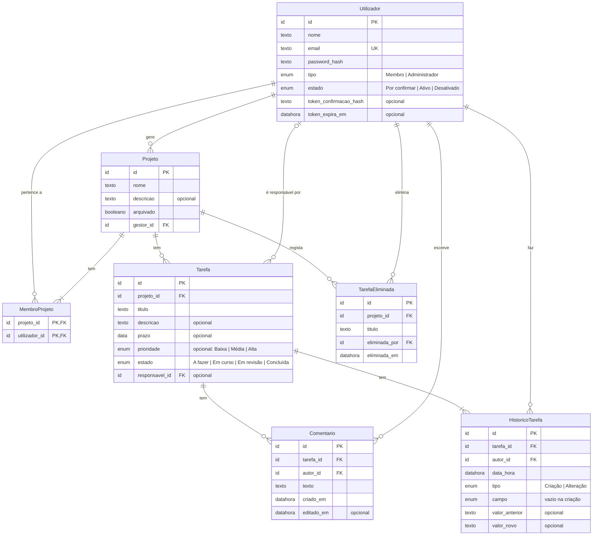

# Modelo de dados — Matriz

Este documento descreve o modelo conceptual de dados do MVP da Matriz:
entidades, atributos, relações, cardinalidades e regras de integridade. Os
tipos de dados são conceptuais; a base de dados concreta continua por decidir
(**D02**, ver [constraints.md](constraints.md)). Não inclui SQL.

## 1. Entidades

| Entidade            | Descrição                                                         | Requisitos                    |
|---------------------|-------------------------------------------------------------------|-------------------------------|
| **Utilizador**      | Conta de uma pessoa: Membro ou Administrador                      | RF01, RF02, RF14, S01, S07    |
| **Projeto**         | Projeto de uma equipa, com um único Gestor                        | RF03, RF08, PR01, PR04        |
| **MembroProjeto**   | Associação entre Utilizador e Projeto: quem pertence a que projeto | RN06, RF04                    |
| **Tarefa**          | Trabalho a fazer dentro de um projeto                             | RF05, RF06, RF07, RN10, RN11, RN13 |
| **Comentario**      | Comentário de um membro numa tarefa                               | RF12                          |
| **HistoricoTarefa** | Entrada do histórico de uma tarefa: criação ou alteração de um campo | RF13                       |
| **TarefaEliminada** | Registo de uma tarefa eliminada: título, quem e quando            | RF09, PR08                    |

Não são entidades:

- **Percentagem de conclusão** — é calculada a partir dos estados das tarefas
  (PR09), por isso não é guardada.
- **Sessões** — dependem do mecanismo de autenticação (D06).
- **Etiquetas** — a US15 está fora do MVP.

## 2. Atributos

Legenda: **PK** identificador; **FK** referência a outra entidade;
*obrig.* obrigatório; *opc.* opcional.

### Utilizador

| Atributo                 | Tipo conceptual | Restrições                                   | Origem          |
|--------------------------|-----------------|----------------------------------------------|-----------------|
| `id`                     | identificador   | PK                                           |                 |
| `nome`                   | texto           | obrig.                                       | US01, S07       |
| `email`                  | texto           | obrig., único, do domínio da empresa         | RN02, IF01      |
| `password_hash`          | texto           | obrig.; nunca a palavra-passe em claro       | S01             |
| `tipo`                   | enumerado       | Membro / Administrador                       | RN16, RN19      |
| `estado`                 | enumerado       | Por confirmar / Ativo / Desativado           | US01, US14      |
| `token_confirmacao_hash` | texto           | opc.; limpo ao confirmar a conta             | RN03, S05       |
| `token_expira_em`        | data-hora       | opc.; 24 h após gerar o link                 | RN03, S05       |

### Projeto

| Atributo    | Tipo conceptual | Restrições                     | Origem       |
|-------------|-----------------|--------------------------------|--------------|
| `id`        | identificador   | PK                             |              |
| `nome`      | texto           | obrig.                         | PR04         |
| `descricao` | texto           | opc.                           | PR04         |
| `arquivado` | booleano        | obrig.; começa a falso         | RN15, US08   |
| `gestor_id` | identificador   | FK → Utilizador, obrig.        | RN05, PR01   |

### MembroProjeto

| Atributo        | Tipo conceptual | Restrições                         | Origem       |
|-----------------|-----------------|------------------------------------|--------------|
| `projeto_id`    | identificador   | PK (composta), FK → Projeto        | RF04         |
| `utilizador_id` | identificador   | PK (composta), FK → Utilizador     | RF04         |

A chave composta impede que alguém fique duplicado no mesmo projeto
(US04 crit. 3).

### Tarefa

| Atributo         | Tipo conceptual | Restrições                                                  | Origem        |
|------------------|-----------------|-------------------------------------------------------------|---------------|
| `id`             | identificador   | PK                                                          |               |
| `projeto_id`     | identificador   | FK → Projeto, obrig.                                        |               |
| `titulo`         | texto           | obrig.                                                      | RN10          |
| `descricao`      | texto           | opc.                                                        | RN10          |
| `prazo`          | data            | opc.; qualquer data, incluindo passadas                     | RN10, RN12    |
| `prioridade`     | enumerado       | opc.; Baixa / Média / Alta                                  | RN10          |
| `estado`         | enumerado       | obrig.; A fazer / Em curso / Em revisão / Concluída; começa em "A fazer" | RN13, PR05 |
| `responsavel_id` | identificador   | FK → Utilizador, opc.; no máximo um                         | RN10, RN11    |

Quem criou a tarefa e quando ficam na entrada de criação do histórico, pelo
que não se repetem na Tarefa.

### Comentario

| Atributo     | Tipo conceptual | Restrições                 | Origem       |
|--------------|-----------------|----------------------------|--------------|
| `id`         | identificador   | PK                         |              |
| `tarefa_id`  | identificador   | FK → Tarefa, obrig.        | US12         |
| `autor_id`   | identificador   | FK → Utilizador, obrig.    | US12, PR11   |
| `texto`      | texto           | obrig., não vazio          | US12 crit. 2 |
| `criado_em`  | data-hora       | obrig.                     | US12 crit. 1 |
| `editado_em` | data-hora       | opc.                       | US12 crit. 3 |

### HistoricoTarefa

| Atributo         | Tipo conceptual | Restrições                                                         | Origem       |
|------------------|-----------------|--------------------------------------------------------------------|--------------|
| `id`             | identificador   | PK                                                                 |              |
| `tarefa_id`      | identificador   | FK → Tarefa, obrig.                                                | US13         |
| `autor_id`       | identificador   | FK → Utilizador, obrig.                                            | US13         |
| `data_hora`      | data-hora       | obrig.                                                             | US13         |
| `tipo`           | enumerado       | Criação / Alteração                                                | US13 crit. 1 |
| `campo`          | enumerado       | titulo / descricao / estado / prazo / prioridade / responsavel; vazio na criação | US13 crit. 1 |
| `valor_anterior` | texto           | opc.                                                               | US13 crit. 1 |
| `valor_novo`     | texto           | opc.                                                               | US13 crit. 1 |

Os valores são guardados como texto, para que o histórico não mude depois de
registado. Estado e prioridade são guardados como códigos (ex.: `EM_CURSO`,
`ALTA`), os mesmos da API, e traduzidos ao mostrar (PR18); o responsável é
guardado pelo nome (ex.: "Ana Exemplo").

### TarefaEliminada

| Atributo        | Tipo conceptual | Restrições                 | Origem       |
|-----------------|-----------------|----------------------------|--------------|
| `id`            | identificador   | PK                         |              |
| `projeto_id`    | identificador   | FK → Projeto, obrig.       | US09 crit. 4 |
| `titulo`        | texto           | obrig.                     | PR08         |
| `eliminada_por` | identificador   | FK → Utilizador, obrig.    | PR08         |
| `eliminada_em`  | data-hora       | obrig.                     | PR08         |

## 3. Relações e cardinalidades

| Relação                                  | Cardinalidade               | Notas                                                    |
|------------------------------------------|-----------------------------|----------------------------------------------------------|
| Utilizador **gere** Projeto              | 1 — 0..N                    | Cada projeto tem exatamente um Gestor (PR01)             |
| Utilizador **pertence a** Projeto        | N:M, através de MembroProjeto | Um projeto tem pelo menos um membro: o Gestor          |
| Projeto **tem** Tarefa                   | 1 — 0..N                    |                                                          |
| Utilizador **é responsável por** Tarefa  | 0..1 — 0..N                 | Uma tarefa pode ficar sem responsável (RN08, RN18)       |
| Tarefa **tem** Comentario                | 1 — 0..N                    |                                                          |
| Utilizador **escreve** Comentario        | 1 — 0..N                    |                                                          |
| Tarefa **tem** HistoricoTarefa           | 1 — 1..N                    | Há sempre pelo menos a entrada de criação                |
| Utilizador **faz** HistoricoTarefa       | 1 — 0..N                    |                                                          |
| Projeto **regista** TarefaEliminada      | 1 — 0..N                    |                                                          |
| Utilizador **elimina** TarefaEliminada   | 1 — 0..N                    |                                                          |

## 4. Diagrama ER

## 5. Regras de integridade

Regras que o diagrama não mostra e que a aplicação tem de garantir:

| ID   | Regra                                                                                                              | Origem            |
|------|--------------------------------------------------------------------------------------------------------------------|-------------------|
| RI01 | O Gestor de um projeto também consta em MembroProjeto desse projeto e não pode ser removido dele.                  | US04 crit. 5, PR14 |
| RI02 | O responsável de uma tarefa tem de ser membro do projeto e ter a conta ativa.                                      | US05 crit. 4, US14 crit. 5 |
| RI03 | Um Administrador nunca é Gestor, membro de projeto, responsável de tarefa nem autor de comentários. Só aparece como autor no histórico pelas alterações que resultam das ações da US14 (ver RI05). | RN19, US14 |
| RI04 | Remover um membro de um projeto tira-o de responsável das tarefas não concluídas desse projeto.                   | RN08              |
| RI05 | Desativar uma conta tira-a de responsável das tarefas não concluídas em todos os projetos, incluindo arquivados. Cada uma destas alterações fica no histórico, com o Administrador que desativou a conta como autor. | RN18, US13 crit. 1, US14 crit. 2 |
| RI06 | Uma pessoa desativada mantém-se em MembroProjeto; ao ser reativada volta como Membro, sem tarefas nem papel de Gestor. | PR15         |
| RI07 | Antes de desativar um Gestor, cada projeto dele recebe um novo Gestor, Membro ativo; se não for membro, passa a sê-lo. | RN17, PR14   |
| RI08 | As contas de Administrador estão sempre ativas: não podem ser desativadas na Matriz.                              | RN21              |
| RI09 | Eliminar uma tarefa apaga os seus comentários e histórico e cria um registo em TarefaEliminada.                    | PR08              |
| RI10 | Num projeto arquivado não se cria, altera nem apaga nada; exceções: reativar o projeto, pelo Gestor (US08), e as ações da US14. | RN15, US08 crit. 3, US14 crit. 4 |
| RI11 | As entradas do histórico nunca são editadas nem apagadas (exceto ao eliminar a tarefa, RI09).                     | PR12              |
| RI12 | Criar uma tarefa ou alterar título, descrição, estado, prazo, prioridade ou responsável gera uma entrada no histórico. | RF13, US13 crit. 1 |
| RI13 | O email é único e pertence ao domínio da empresa.                                                                  | RN02, US01 crit. 4–5 |
| RI14 | O token de confirmação é guardado em hash, expira 24 h depois de gerado, é substituído quando se pede novo link e é limpo quando a conta é confirmada. | RN03, S05, US01 crit. 7 |
| RI15 | Projetos e utilizadores nunca são apagados (só arquivados ou desativados), pelo que as referências a eles se mantêm válidas. | RN15, RN18 |
| RI16 | Só Membros com conta ativa podem ser adicionados a um projeto (nunca Administradores, contas por confirmar ou desativadas). | US04 crit. 1, US14 crit. 5, RN19 |

## 6. Pressupostos e decisões pendentes

**Decisões de modelação tomadas nesta fase:**

- O Administrador é um Utilizador com `tipo = Administrador`, e não uma
  entidade separada; as restrições da RN19 são garantidas pela aplicação (RI03).
- O Gestor é indicado por `gestor_id` no Projeto, o que garante pela estrutura
  um único Gestor por projeto (PR01).
- O link de confirmação é guardado em campos do Utilizador; gerar um novo link
  substitui o anterior (US01 crit. 7).
- Os valores do histórico são guardados como texto; estado e prioridade como
  códigos, traduzidos ao mostrar (PR18).

**Continuam pendentes** (ver [constraints.md](constraints.md)):

| ID   | Impacto no modelo                                                                                 |
|------|---------------------------------------------------------------------------------------------------|
| D02  | Base de dados concreta e tipos de dados reais.                                                    |
| D06  | Se as sessões forem guardadas na base de dados, será preciso uma entidade de sessão.              |
| D07  | Como as contas de Administrador são criadas na instalação.                                        |
| D08  | Edição simultânea da mesma tarefa: pode exigir um campo de versão na Tarefa.                      |
| D09  | Limite de tentativas de login: pode exigir campos de contagem/bloqueio no Utilizador.             |
| D10  | Pedido de apagamento de dados (RGPD): o histórico e os comentários guardam nomes de pessoas.      |
| IF01 | Domínio de email da empresa, necessário para validar a RI13.                                      |
| —    | Tamanhos máximos dos textos (título, descrição, comentário): não definidos nos requisitos.        |
